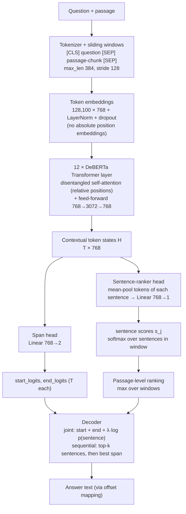
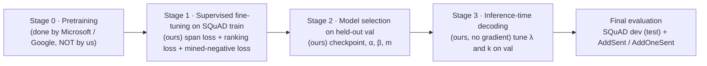

# Evidence-Guided Extractive QA on SQuAD v1.1

CS4248 (AY2026/27 Sem 1) · Group G14 · Topic II: Extractive Question Answering

Given a question and a Wikipedia passage, the system returns the answer as a span copied from the passage. We fine-tune a pretrained **DeBERTa-v3-base** encoder with two output heads:
- a **span head**, which predicts where the answer starts and ends;
- a **sentence-ranker head**, which ranks the passage's sentences by how likely they are to contain the answer.

The ranker is trained with **model-mined hard negatives**. At inference, its scores guide answer selection, either **jointly** or **sequentially** (rank the sentences, then read the top-k).

> **Status:** code frozen. Every validation run is recorded in `results/runs/`, and the test-set numbers come from one run of `scripts/run_all.sh` (§6.6). Setup and reproduction are in §6.

---

## 1. Systems compared

| System | Encoder | Heads | Purpose |
|---|---|---|---|
| BERT span-only | `bert-base-uncased` | span | Reproduce the standard baseline (Devlin et al., 2019) |
| DeBERTa span-only | `microsoft/deberta-v3-base` | span | Strong baseline; equals "our model without the ranking objective" |
| **Ours: evidence-guided DeBERTa** | `microsoft/deberta-v3-base` | span + sentence ranker | Proposed model |
| BM25 sentence ranker | none (lexical) | n/a | Reference ranker, and stage 1 of a classic rank-then-read pipeline |

---

## 2. Model architecture

### 2.1 End-to-end picture



### 2.2 Layer-by-layer (DeBERTa-v3-base)

| # | Component | Layers / shapes | Parameters | Source |
|---|---|---|---|---|
| 1 | **Tokenizer** | SentencePiece, 128K vocabulary. Input `[CLS] q [SEP] c [SEP]`, padded/truncated to 384 tokens. Long passages are split into overlapping windows (stride 128) | n/a | pretrained (external) |
| 2 | **Embedding layer** | Token embedding `128,100 × 768` → LayerNorm → dropout 0.1. DeBERTa-v3 uses **no absolute position embeddings in the input** and **no segment (token-type) embeddings**; position enters through relative attention | ≈ 98M | pretrained |
| 3 | **Encoder: 12 identical Transformer layers**, each containing: | | ≈ 86M total | pretrained |
| 3a | *Disentangled self-attention*: 12 heads × 64 dims. Content and relative position are encoded separately, and the attention score is the sum of **content→content**, **content→position** and **position→content** terms. Relative distances are bucketed (256 buckets, log-scale for long distances). Q/K projections are shared between content and position (`share_att_key`) | Q, K, V: `768×768` each; output projection `768×768` | | |
| 3b | *Add & LayerNorm* (residual) | `768` | | |
| 3c | *Feed-forward network*: `Linear 768→3072` → GELU → `Linear 3072→768` → dropout | | | |
| 3d | *Add & LayerNorm* (residual) | `768` | | |
| 3e | Relative-position embedding table (shared across layers) + LayerNorm | `512 × 768` (2 × 256 buckets) | | |
| 4 | **Span head** (ours to train; standard design) | `Linear 768→2` applied to every token → `start_logit_t`, `end_logit_t` | 1,538 | randomly initialised |
| 5 | **Sentence-ranker head** (ours) | For each sentence *j* visible in the window: `h_j = mean(H[t] for t in sentence j)` → dropout → `Linear 768→1` → score `s_j`. Softmax over the window's sentences | 769 | randomly initialised |

**Total:** ≈ 184M parameters, almost all pretrained. Our new heads add about 2.3K parameters, so the method changes **how the model is trained and decoded**, not its size.

Not used at fine-tuning time: DeBERTa's *enhanced mask decoder* and the ELECTRA-style *generator* exist only during pretraining (§3.1) and are not part of the released discriminator checkpoint we fine-tune.

### 2.3 BERT-base baseline (for comparison)

| Component | `bert-base-uncased` |
|---|---|
| Tokenizer | WordPiece, 30,522 vocabulary, lower-cased |
| Embeddings | Token + **learned absolute position** (512) + **segment** (2) embeddings → LayerNorm |
| Encoder | 12 layers, hidden 768, 12 heads, FFN 3072, standard (non-disentangled) self-attention |
| Head | Same span head, `Linear 768→2` |
| Parameters | ≈ 110M |

Main architectural differences from DeBERTa-v3: absolute vs. **relative disentangled** position modelling, a 30K vs. 128K vocabulary, and MLM+NSP vs. **replaced-token-detection** pretraining.

---

## 3. Training pipeline: what is pretraining vs. post-training



### 3.1 Stage 0: Pretraining (external, not performed by us)

We **do not pretrain** or continue pretraining any model. We download public checkpoints from Hugging Face.

| Checkpoint | Pretraining objective | Pretraining data |
|---|---|---|
| `microsoft/deberta-v3-base` (He et al., 2023) | **Replaced Token Detection** (ELECTRA-style): a small generator corrupts tokens and the discriminator (our encoder) predicts, for every token, whether it was replaced. Uses **gradient-disentangled embedding sharing** between generator and discriminator | ≈ 160GB text: Wikipedia, BookCorpus, OpenWebText, CC-News, Stories (same corpus as DeBERTa) |
| `bert-base-uncased` (Devlin et al., 2019) | **Masked Language Modelling** (15% tokens) + **Next Sentence Prediction** | BooksCorpus (800M words) + English Wikipedia (2.5B words) |

**Caveat for the report:** both corpora include English Wikipedia, and SQuAD passages come from Wikipedia. The encoders may therefore have seen the *passages* (not the questions or answers) during pretraining. This applies equally to every system we compare, so comparisons stay fair. We note it under Limitations.

### 3.2 Stage 1: Post-training = supervised task fine-tuning (ours)

This is the only stage that updates weights. **All encoder layers and both heads are fine-tuned end to end**: no layers are frozen, no adapters/LoRA, no instruction tuning, no RLHF.

| Item | Setting |
|---|---|
| Data | SQuAD v1.1 `train-v1.1.json`, split by article (seed 2026): **train** 398 articles, 78,259 questions; **val** 44 articles, 9,340 questions (`results/tables/data_stats.csv`). Val has one reference answer per question, so its EM is lower than on dev, which has about three |
| Extra training data | None. Evidence labels and negatives are derived automatically from the existing answer offsets: **no manual annotation** |
| Objective | `L = (L_start + L_end) / 2 + α · L_rank + β · L_neg` |
| `L_start`, `L_end` | Cross-entropy over token positions for the gold start/end (CLS if the answer is not in this window) |
| `L_rank` | Listwise cross-entropy over the window's sentences, target = **gold evidence sentence** (the one containing `answer_start`) |
| `L_neg` | Margin loss `max(0, m − s_gold + s_neg)`. `s_neg` = score of the **highest-scoring non-gold sentence under the current model** (mined online each step). Sentences containing the answer string are never used as negatives |
| Optimiser | AdamW, weight decay 0.01, linear LR decay, 10% warm-up, bf16 |
| Hyper-parameters | LR / epochs / warm-up tuned on val for DeBERTa span-only (12 runs), then frozen for every DeBERTa variant: **LR 3e-5, 2 epochs, warm-up 10%**, max length 384, stride 128 ([`configs/deberta_span/best.yaml`](configs/deberta_span/best.yaml)). `α, β, m, λ` tuned on val (12 runs × 5 λ): **α = 0.3, β = 0.5, m = 1.0, λ = 0.25** ([`configs/evidence/best.yaml`](configs/evidence/best.yaml)). Sequential decoding: **k = 2**, set on val ([`configs/final_checkpoints.yaml`](configs/final_checkpoints.yaml)). DeBERTa-v3-large (R8): LR 2e-5 |
| Seeds | 13, 42, 87 (every reported number is mean ± std over 3 seeds) |

Negative-mining variants used in ablations (`neg_mode`): `model` (ours), `lexical` (BM25-closest sentence to the question, from the original proposal), `random`, `none`.

### 3.3 Stage 2: Model selection (ours, no new training)
- Pick the best checkpoint by **val F1**.
- Tune `α, β, m` on val only.
- `dev-v1.1.json` is used only once, for the final frozen checkpoints.

### 3.4 Stage 3: Inference-time decoding (ours, no gradient updates)

1. Run the encoder on every window and collect start/end logits and sentence scores.
2. **Passage-level sentence ranking:** each sentence's log-probability is the max over the windows that contain it.
3. Pick the answer with one of two decoders:
   - **Joint decoding:** over all candidate spans (≤ 30 tokens, start ≤ end, top-20 starts × top-20 ends), choose the highest `start_logit + end_logit + λ · log p(sentence containing span)`.
   - **Sequential (rank-then-read) decoding:** keep only the top-`k` ranked sentences, then choose the best span inside them. EM is capped by the ranker's Recall@k, which we report.
4. Map the chosen token span back to the original text with the tokenizer's offset mapping.

`λ` and `k` are tuned on val. With `λ = 0` and `k = all` this is exactly the standard BERT-style decoder.

---

## 4. Evaluation

- **Answer quality:** Exact Match and macro F1 from the **official, unmodified** `evaluate-v2.0.py` (works on v1.1 data).
- **Evidence quality:** Recall@1, Recall@3 and MRR of the sentence ranker, against BM25 and against the sentence containing the span-only model's answer.
- **Robustness:** AddSent / AddOneSent (Jia & Liang, 2017), **evaluation only, never trained on**.
- **Significance:** paired bootstrap and approximate randomisation on per-question scores.
- **Ablations:** −ranking objective, −negatives, random vs. lexical vs. model-mined negatives, −evidence in decoding, joint vs. sequential.

Results tables are generated into `results/tables/` (val, AddSent/AddOneSent, efficiency) and `results/tables/test/` (test), never edited by hand. §6.5 and §6.6 give the command behind each one.

---

## 5. Our implementation vs. external components

| Ours (implemented by G14) | External (cited, not ours) |
|---|---|
| Article-level data split and feature pipeline | Hugging Face Transformers / Datasets, PyTorch |
| Evidence labelling, negative candidates, BM25/random negatives | Pretrained `deberta-v3-base` and `bert-base-uncased` checkpoints |
| Sentence-ranker head, joint loss, online model-mined negatives | Official SQuAD evaluation script [`src/qa/eval/evaluate-v2.0.py`](src/qa/eval/evaluate-v2.0.py), committed unmodified (Rajpurkar et al.) |
| | SQuAD v1.1 data in [`data/raw/`](data/raw/README.md), CC BY-SA 4.0 (Rajpurkar et al., 2016) |
| Passage-level ranking, joint and sequential decoders | Sentence splitter (spaCy / pysbd), BM25 implementation |
| Training/eval scripts, error analysis, significance tests | Adversarial SQuAD data (Jia & Liang, 2017) |

---

## 6. Setup and reproduction

All commands run from the repository root. Training and test-set prediction need a GPU with bf16 support (compute capability ≥ 8.0). Everything else, including the test suite and every table built from saved outputs, runs on CPU.

### 6.1 Environment

```bash
python3.12 -m venv .venv
.venv/bin/python -m pip install -r requirements.txt
.venv/bin/python -m spacy download en_core_web_sm   # error analysis only
export PYTHONPATH=src                                # the package lives in src/qa
.venv/bin/python -m pytest -q                        # tiny offline models, CPU, a few minutes
```

The scripts use `.venv/bin/python` when it exists (override with `QA_PYTHON=...`). Pretrained encoders come from the Hugging Face Hub (`microsoft/deberta-v3-base`, `microsoft/deberta-v3-large`, `bert-base-uncased`). The Slurm jobs set `HF_HUB_OFFLINE=1`, so download each encoder into the cache once beforehand.

**SoC Compute Cluster notes** (we trained every model there):
- Build the `.venv` on a compute node (`srun --gpus=1 --pty bash`). The login node can't load torch's CUDA libraries. Set `TMPDIR=~/tmp` for pip, because `/tmp` on the login node has a 50 MB quota.
- Compute nodes are offline. Fetch encoders on the login node without importing torch:
  ```bash
  HF_HUB_DISABLE_XET=1 .venv/bin/python -c "from huggingface_hub import snapshot_download; print(snapshot_download('microsoft/deberta-v3-base', max_workers=1, ignore_patterns=['*.h5','*.msgpack','*.onnx','*.ot','*.bin']))"
  ```
- Every reported run used `--gpus=h100-47` (H100 NVL MIG 3g.47gb). The same setting moves about 0.2 F1 across GPU types, which is as much as the seed. `xgpj0` is aarch64, so it is excluded, and the jobs check for `EXPECT_GPU` before training. Jobs are capped at 3 hours.
- Keep `git status` clean before submitting, so each run record's `git_sha` is exact. `squad_io prepare` rewrites `results/tables/data_stats.csv`; restore it with `git checkout -- results/tables/`.

### 6.2 Data

SQuAD v1.1 is committed at `data/raw/` (`train-v1.1.json`, `dev-v1.1.json`, CC BY-SA 4.0). `dev-v1.1.json` is our **test set**: only `scripts/run_all.sh` reads it, and only for the frozen checkpoints.

```bash
bash scripts/download_data.sh --check-only                     # SHA-256 of the committed SQuAD files
.venv/bin/python -m qa.data.squad_io prepare                   # article split -> data/processed/{train,val}.json, data_stats table
.venv/bin/python -m qa.data.evidence_labels --input data/processed/train.json --split train   # evidence labels + negative candidates
.venv/bin/python -m qa.data.evidence_labels --input data/processed/val.json --split val
bash scripts/download_data.sh --source codalab                 # AddSent / AddOneSent (evaluation only)
```

`bash scripts/run_all.sh data` runs the check, the split, the val, test and adversarial evidence files, and the AddSent download in one go. It needs internet, so on the cluster run it on the login node.

### 6.3 Trained checkpoints

The 18 final checkpoints (R2, R3, R4, R5, R6, R6b × seeds 13, 42, 87) are too large for git. They are in the team's [shared Drive folder](https://drive.google.com/drive/folders/1fJYkE0xgxRaffQ0tc6TtY7jABdjEQabF). [`configs/final_checkpoints.yaml`](configs/final_checkpoints.yaml) lists each one with the SHA-256 of its `model.pt`. To place and check them:

```bash
mkdir -p outputs/<run_id>_s<seed>/best && unzip -j <run_id>_s<seed>.zip -d outputs/<run_id>_s<seed>/best
bash scripts/run_all.sh verify                                 # 18 x "ok", exit 0
```

R7 (λ = 0) and the sequential pipelines R9a/R9b re-decode R3/R4 outputs, so they have no checkpoint of their own. R8 (DeBERTa-v3-large, seed 42) is a scaling check that never touches test, and its checkpoint stays on the cluster.

### 6.4 Training (val only)

Each job trains, picks the best epoch by val F1, and writes the run record `results/runs/<run_id>_s<seed>.json` (EM, F1, config, `git_sha`, GPU hours). Without Slurm, run the `python -m qa.train` line inside the job file directly, e.g. `python -m qa.train --config configs/deberta_span/span_only.yaml --seed 42 --record`.

| Run | What | Command | Owner |
|---|---|---|---|
| Grid | DeBERTa span-only hyper-parameters (12 runs, seed 42) | `sbatch configs/deberta_span/d3_slurm.sbatch` | Damian |
| R1 | BM25 sentence ranker (no training) | `python -m qa.baselines.bm25_ranker --split val` | Jun Yip |
| R2 | BERT-base span-only, 3 seeds | `sbatch configs/baselines/r2_slurm.sbatch` | Clemen |
| R3 | DeBERTa-v3-base span-only, 3 seeds | `sbatch configs/deberta_span/r3_slurm.sbatch` | Damian |
| Grid | Evidence-model α, β, m × 5 λ (12 runs, seed 42) | `sbatch --array=0-11%3 configs/evidence/g3_slurm.sbatch` | Gokul |
| R4 + R7 | Full model; R7 re-decodes it at λ = 0 | `sbatch configs/ablations/ablation_slurm.sbatch configs/ablations/r4_full.yaml configs/ablations/r7_no_evidence_decoding.yaml` | Gokul |
| R5 | No negatives | `sbatch configs/ablations/ablation_slurm.sbatch configs/ablations/r5_no_negatives.yaml` | Xin Hui |
| R6 | Random negatives | `sbatch configs/ablations/ablation_slurm.sbatch configs/ablations/r6_random_negatives.yaml` | Jun Yip |
| R6b | Lexical (BM25) negatives | `sbatch configs/ablations/ablation_slurm.sbatch configs/ablations/r6b_lexical_negatives.yaml` | Clemen |
| R8 | DeBERTa-v3-large span-only, seed 42 (scaling check) | `sbatch configs/deberta_span/r8_slurm.sbatch` | Damian |

Before running `sbatch`, run `mkdir -p logs`. A run takes 17–55 minutes on `h100-47`. `bash configs/ablations/run_ablation.sh summary` checks that each ablation has all three seed records.

### 6.5 Validation and efficiency tables

These read only the committed run records, or outputs on val and AddSent/AddOneSent, never test.

| Table | Command | Output |
|---|---|---|
| Data statistics | `python -m qa.data.squad_io prepare` | `results/tables/data_stats.{csv,tex}` |
| Val EM/F1, mean ± std over seeds | `python scripts/make_tables.py --runs-dir results/runs --out-dir results/tables` | `results/tables/run_summary.{csv,tex}` |
| Literature comparison (published SQuAD v1.1 dev) | `python scripts/make_tables.py --literature --out-dir results/tables` | `results/tables/literature_squad11.*` |
| Ranking quality on val (Recall@1/3, MRR) | `python -m qa.eval.evidence_metrics table --split val` | `results/tables/ranking_val.*` |
| Robustness (AddSent / AddOneSent) and ranking on them | `bash scripts/run_all.sh adversarial` (GPU) | `results/tables/adversarial_*`, `ranking_add*`, `results/figures/adversarial_f1_drop.*` |
| Efficiency: timing | `sbatch configs/efficiency/d5_slurm.sbatch` (GPU, about 10 min) | `results/efficiency/timings.json` |
| Efficiency: table | `bash scripts/run_all.sh efficiency` (imports torch: run it on a compute node, not the login node) | `results/tables/efficiency.{csv,tex}` |
| Ablation table with seed-42 tests against R4 | `bash configs/ablations/run_ablation.sh table` | `results/tables/ablations_val.{csv,tex}`, `ablations_val_significance.json`, `ablations_val_macros.tex` |
| Val F1 against λ for the evidence-model grid | `bash configs/evidence/g3_grid.sh curve` | `results/figures/lambda_curve.{pdf,png}`, `results/tables/lambda_curve_macros.tex` |
| Negative-sample audit (100 questions) | `python -m qa.eval.negative_audit count` | `results/audits/j3_counts.json` |

The val ranking table needs each run's `outputs/<run_id>_s<seed>/val.sent_rank.json` (evidence models) or `val.nbest.json` (R3, span-implied). The training jobs and `predict.py --evidence` write these.

### 6.6 Test set (once, frozen checkpoints only)

[`scripts/run_all.sh`](scripts/run_all.sh) is the only code path that reads `dev-v1.1.json`. λ = 0.25 and k = 2 come from `configs/final_checkpoints.yaml`, both chosen on val. Nothing is chosen on test. The final run is done: its 27 records and tables are committed in `results/runs/test/` and `results/tables/`, so the commands below are for reproducing them.

```bash
bash scripts/run_all.sh verify      # checkpoint hashes (login node)
bash scripts/run_all.sh data        # evidence files incl. test (login node, internet)
sbatch configs/final_test.sbatch    # one GPU job: verify, test, sequential, ranking, adversarial, errors
bash scripts/run_all.sh tables      # then: test tables (CPU)
bash scripts/run_all.sh efficiency  # efficiency table (compute node: imports torch)
```

| Stage | What it produces |
|---|---|
| `test` | EM/F1 records for R2–R6b × 3 seeds, plus R7 (R4 at λ = 0): `results/runs/test/*.json`. Their ranking fields are null; the test ranking is in `ranking_test.*` |
| `sequential` | R9a (BM25 top-2 → R3 reader) and R9b (R4's own top-2 → R4 reader), 3 seeds each |
| `ranking` | Recall@1/3 and MRR on test: `results/tables/ranking_test.*` |
| `adversarial` | As in §6.5 |
| `errors` | Error analysis of R3 and R4, seed 42 |
| `tables` | `results/tables/test/run_summary.{csv,tex}`, mean ± std over seeds |

`bash scripts/run_all.sh all` runs every stage in order. A finished run should hold 27 test records (18 + 3 R7 + 6 R9). A record that already exists is skipped, so a resubmit after a failure continues where it stopped. Significance tests on the test records are not wired into `run_all.sh` yet (see its header).

---

## References

- Devlin et al. (2019). BERT: Pre-training of Deep Bidirectional Transformers for Language Understanding. NAACL.
- He, Liu, Gao & Chen (2021). DeBERTa: Decoding-enhanced BERT with Disentangled Attention. ICLR.
- He, Gao & Chen (2023). DeBERTaV3: Improving DeBERTa using ELECTRA-Style Pre-Training with Gradient-Disentangled Embedding Sharing. ICLR.
- Clark et al. (2020). ELECTRA: Pre-training Text Encoders as Discriminators Rather Than Generators. ICLR.
- Rajpurkar et al. (2016). SQuAD: 100,000+ Questions for Machine Comprehension of Text. EMNLP.
- Jia & Liang (2017). Adversarial Examples for Evaluating Reading Comprehension Systems. EMNLP.
- Min et al. (2018). Efficient and Robust Question Answering from Minimal Context over Documents. ACL.
