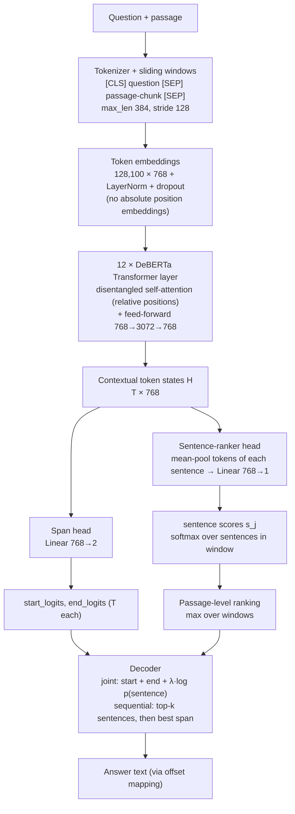
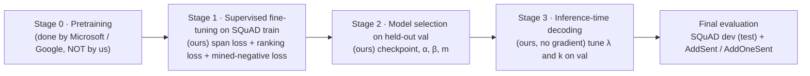

# Evidence-Guided Extractive QA on SQuAD v1.1

CS4248 (AY2026/27 Sem 1) · Group G14 · Topic II: Extractive Question Answering

Given a question and a Wikipedia passage, the system returns the answer as a span copied from the passage. We fine-tune a pretrained **DeBERTa-v3-base** encoder with two output heads:
- a **span head**, which predicts where the answer starts and ends;
- a **sentence-ranker head**, which ranks the passage's sentences by how likely they are to contain the answer.

The ranker is trained with **model-mined hard negatives**. At inference, its scores guide answer selection, either **jointly** or **sequentially** (rank the sentences, then read the top-k).

> **Status:** design document. The architecture below is what we are implementing. Sections marked *TBD* are filled in as runs complete. Work split and milestones are in [TEAM_TASKS.md](docs/TEAM_TASKS.md).

---

## 1. Systems compared

| System | Encoder | Heads | Purpose |
|---|---|---|---|
| BERT span-only | `bert-base-uncased` | span | Reproduce the standard baseline (Devlin et al., 2019) |
| DeBERTa span-only | `microsoft/deberta-v3-base` | span | Strong baseline; equals "our model without the ranking objective" |
| **Ours: evidence-guided DeBERTa** | `microsoft/deberta-v3-base` | span + sentence ranker | Proposed model |
| BM25 sentence ranker | none (lexical) | n/a | Reference ranker, and stage 1 of a classic rank-then-read pipeline |

---

## 2. Model architecture

### 2.1 End-to-end picture

### 2.2 Layer-by-layer (DeBERTa-v3-base)

| # | Component | Layers / shapes | Parameters | Source |
|---|---|---|---|---|
| 1 | **Tokenizer** | SentencePiece, 128K vocabulary. Input `[CLS] q [SEP] c [SEP]`, padded/truncated to 384 tokens. Long passages are split into overlapping windows (stride 128) | n/a | pretrained (external) |
| 2 | **Embedding layer** | Token embedding `128,100 × 768` → LayerNorm → dropout 0.1. DeBERTa-v3 uses **no absolute position embeddings in the input** and **no segment (token-type) embeddings**; position enters through relative attention | ≈ 98M | pretrained |
| 3 | **Encoder: 12 identical Transformer layers**, each containing: | | ≈ 86M total | pretrained |
| 3a | *Disentangled self-attention*: 12 heads × 64 dims. Content and relative position are encoded separately, and the attention score is the sum of **content→content**, **content→position** and **position→content** terms. Relative distances are bucketed (256 buckets, log-scale for long distances). Q/K projections are shared between content and position (`share_att_key`) | Q, K, V: `768×768` each; output projection `768×768` | | |
| 3b | *Add & LayerNorm* (residual) | `768` | | |
| 3c | *Feed-forward network*: `Linear 768→3072` → GELU → `Linear 3072→768` → dropout | | | |
| 3d | *Add & LayerNorm* (residual) | `768` | | |
| 3e | Relative-position embedding table (shared across layers) + LayerNorm | `512 × 768` (2 × 256 buckets) | | |
| 4 | **Span head** (ours to train; standard design) | `Linear 768→2` applied to every token → `start_logit_t`, `end_logit_t` | 1,538 | randomly initialised |
| 5 | **Sentence-ranker head** (ours) | For each sentence *j* visible in the window: `h_j = mean(H[t] for t in sentence j)` → dropout → `Linear 768→1` → score `s_j`. Softmax over the window's sentences | 769 | randomly initialised |

**Total:** ≈ 184M parameters, almost all pretrained. Our new heads add about 2.3K parameters, so the method changes **how the model is trained and decoded**, not its size.

Not used at fine-tuning time: DeBERTa's *enhanced mask decoder* and the ELECTRA-style *generator* exist only during pretraining (§3.1) and are not part of the released discriminator checkpoint we fine-tune.

### 2.3 BERT-base baseline (for comparison)

| Component | `bert-base-uncased` |
|---|---|
| Tokenizer | WordPiece, 30,522 vocabulary, lower-cased |
| Embeddings | Token + **learned absolute position** (512) + **segment** (2) embeddings → LayerNorm |
| Encoder | 12 layers, hidden 768, 12 heads, FFN 3072, standard (non-disentangled) self-attention |
| Head | Same span head, `Linear 768→2` |
| Parameters | ≈ 110M |

Main architectural differences from DeBERTa-v3: absolute vs. **relative disentangled** position modelling, a 30K vs. 128K vocabulary, and MLM+NSP vs. **replaced-token-detection** pretraining.

---

## 3. Training pipeline: what is pretraining vs. post-training

### 3.1 Stage 0: Pretraining (external, not performed by us)

We **do not pretrain** or continue pretraining any model. We download public checkpoints from Hugging Face.

| Checkpoint | Pretraining objective | Pretraining data |
|---|---|---|
| `microsoft/deberta-v3-base` (He et al., 2023) | **Replaced Token Detection** (ELECTRA-style): a small generator corrupts tokens and the discriminator (our encoder) predicts, for every token, whether it was replaced. Uses **gradient-disentangled embedding sharing** between generator and discriminator | ≈ 160GB text: Wikipedia, BookCorpus, OpenWebText, CC-News, Stories (same corpus as DeBERTa) |
| `bert-base-uncased` (Devlin et al., 2019) | **Masked Language Modelling** (15% tokens) + **Next Sentence Prediction** | BooksCorpus (800M words) + English Wikipedia (2.5B words) |

**Caveat for the report:** both corpora include English Wikipedia, and SQuAD passages come from Wikipedia. The encoders may therefore have seen the *passages* (not the questions or answers) during pretraining. This applies equally to every system we compare, so comparisons stay fair. We note it under Limitations.

### 3.2 Stage 1: Post-training = supervised task fine-tuning (ours)

This is the only stage that updates weights. **All encoder layers and both heads are fine-tuned end to end**: no layers are frozen, no adapters/LoRA, no instruction tuning, no RLHF.

| Item | Setting |
|---|---|
| Data | SQuAD v1.1 `train-v1.1.json`, about 90% of articles (≈ 79k questions). The other ≈ 10% of articles is held out as **val** |
| Extra training data | None. Evidence labels and negatives are derived automatically from the existing answer offsets: **no manual annotation** |
| Objective | `L = (L_start + L_end) / 2 + α · L_rank + β · L_neg` |
| `L_start`, `L_end` | Cross-entropy over token positions for the gold start/end (CLS if the answer is not in this window) |
| `L_rank` | Listwise cross-entropy over the window's sentences, target = **gold evidence sentence** (the one containing `answer_start`) |
| `L_neg` | Margin loss `max(0, m − s_gold + s_neg)`. `s_neg` = score of the **highest-scoring non-gold sentence under the current model** (mined online each step). Sentences containing the answer string are never used as negatives |
| Optimiser | AdamW, weight decay 0.01, linear LR decay, 10% warm-up, bf16 |
| Hyper-parameters | LR / epochs tuned on val for DeBERTa span-only, then frozen for every DeBERTa variant. `α, β, m` tuned on val. Values: *TBD* |
| Seeds | 13, 42, 87 (every reported number is mean ± std over 3 seeds) |

Negative-mining variants used in ablations (`neg_mode`): `model` (ours), `lexical` (BM25-closest sentence to the question, from the original proposal), `random`, `none`.

### 3.3 Stage 2: Model selection (ours, no new training)
- Pick the best checkpoint by **val F1**.
- Tune `α, β, m` on val only.
- `dev-v1.1.json` is used only once, for the final frozen checkpoints.

### 3.4 Stage 3: Inference-time decoding (ours, no gradient updates)

1. Run the encoder on every window and collect start/end logits and sentence scores.
2. **Passage-level sentence ranking:** each sentence's log-probability is the max over the windows that contain it.
3. Pick the answer with one of two decoders:
   - **Joint decoding:** over all candidate spans (≤ 30 tokens, start ≤ end, top-20 starts × top-20 ends), choose the highest `start_logit + end_logit + λ · log p(sentence containing span)`.
   - **Sequential (rank-then-read) decoding:** keep only the top-`k` ranked sentences, then choose the best span inside them. EM is capped by the ranker's Recall@k, which we report.
4. Map the chosen token span back to the original text with the tokenizer's offset mapping.

`λ` and `k` are tuned on val. With `λ = 0` and `k = all` this is exactly the standard BERT-style decoder.

---

## 4. Evaluation

- **Answer quality:** Exact Match and macro F1 from the **official, unmodified** `evaluate-v2.0.py` (works on v1.1 data).
- **Evidence quality:** Recall@1, Recall@3 and MRR of the sentence ranker, against BM25 and against the sentence containing the span-only model's answer.
- **Robustness:** AddSent / AddOneSent (Jia & Liang, 2017), **evaluation only, never trained on**.
- **Significance:** paired bootstrap and approximate randomisation on per-question scores.
- **Ablations:** −ranking objective, −negatives, random vs. lexical vs. model-mined negatives, −evidence in decoding, joint vs. sequential.

Results tables: *TBD* (generated into `results/tables/` by `scripts/make_tables.py`).

---

## 5. Our implementation vs. external components

| Ours (implemented by G14) | External (cited, not ours) |
|---|---|
| Article-level data split and feature pipeline | Hugging Face Transformers / Datasets, PyTorch |
| Evidence labelling, negative candidates, BM25/random negatives | Pretrained `deberta-v3-base` and `bert-base-uncased` checkpoints |
| Sentence-ranker head, joint loss, online model-mined negatives | Official SQuAD evaluation script [`src/qa/eval/evaluate-v2.0.py`](src/qa/eval/evaluate-v2.0.py), committed unmodified (Rajpurkar et al.) |
| | SQuAD v1.1 data in [`data/raw/`](data/raw/README.md), CC BY-SA 4.0 (Rajpurkar et al., 2016) |
| Passage-level ranking, joint and sequential decoders | Sentence splitter (spaCy / pysbd), BM25 implementation |
| Training/eval scripts, error analysis, significance tests | Adversarial SQuAD data (Jia & Liang, 2017) |

---

## 6. Setup and reproduction

*TBD (owner: Damian, see [TEAM_TASKS.md](docs/TEAM_TASKS.md) D7; commands come from Clemen's `scripts/run_all.sh`, C9).* This section will cover environment setup, one command per results table, and links to trained checkpoints.

**Data:** SQuAD v1.1 is already in the repo at `data/raw/` (`train-v1.1.json`, `dev-v1.1.json`). Check it with `cd data/raw && shasum -a 256 -c SHA256SUMS`. `dev-v1.1.json` is our **test set**: use it only for final, frozen checkpoints. Adversarial SQuAD (evaluation only) is fetched separately by `scripts/download_data.sh`.

---

## References

- Devlin et al. (2019). BERT: Pre-training of Deep Bidirectional Transformers for Language Understanding. NAACL.
- He, Liu, Gao & Chen (2021). DeBERTa: Decoding-enhanced BERT with Disentangled Attention. ICLR.
- He, Gao & Chen (2023). DeBERTaV3: Improving DeBERTa using ELECTRA-Style Pre-Training with Gradient-Disentangled Embedding Sharing. ICLR.
- Clark et al. (2020). ELECTRA: Pre-training Text Encoders as Discriminators Rather Than Generators. ICLR.
- Rajpurkar et al. (2016). SQuAD: 100,000+ Questions for Machine Comprehension of Text. EMNLP.
- Jia & Liang (2017). Adversarial Examples for Evaluating Reading Comprehension Systems. EMNLP.
- Min et al. (2018). Efficient and Robust Question Answering from Minimal Context over Documents. ACL.
